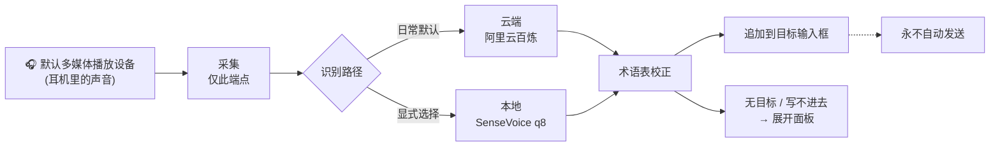
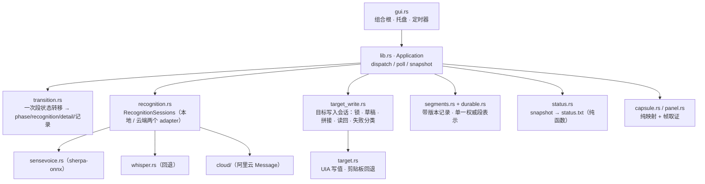

# Listen

**戴着耳机开会时，把对方说的话变成能直接发出去的文字。**

Windows 桌面小工具 · 双击即用 · 不装驱动、不改你的输入习惯、永不自动发送。

| | |
|---|---|
| 平台 | Windows 10 / 11（实测 Windows 11 26200，x64） |
| 语言 | Rust（`app/listen`），PowerShell 打包与验收脚本 |
| 版本 | 0.1.0 |
| 测试 | **374 passed / 0 failed / 16 ignored** |
| 交付包 | 21 个文件 / 253 MiB，无安装器 |
| 默认识别 | 云端（阿里云百炼，已通过 20 段真实语料验收） |
| 本地备用 | SenseVoiceSmall q8（sherpa-onnx 常驻进程内，需 AVX2） |

---

## 它解决什么问题

你在腾讯会议里戴耳机听对方说话，想把内容变成文字，粘到和 AI 的对话框、记事本或任何输入框里。

Listen 常驻在后台，用一个快捷键完成：**采集耳机里正在播放的声音 → 识别 → 追加到你在开始采集时选定的那个输入框**。它不监听麦克风，不录会议，不保存历史，也不会替你按下回车。

---

## 怎么用

1. **点进你要接收文字的输入框**，光标停在那里（这就是「目标输入框」，在开始采集那一刻绑定，之后切换窗口不会改变它）。
2. 按 **`Ctrl+Alt+R`** 开始采集，耳机里正常开会。
3. 再按一次 **`Ctrl+Alt+R`** 停止 → 约 1 秒内，文字追加到那个输入框。

没有可写目标（比如焦点在桌面）时，完整结果直接进**展开面板**，等你复制。



> 只采集**默认多媒体播放设备**。走「通信设备」或单独路由到别处的音节不在范围内；播放设备切换或移除会中断采集、保留已收到的音频并说明原因。

---

## 两条识别路径

| | **云端（日常默认）** | **本地备用（显式选择）** |
|---|---|---|
| 怎么选 | 双击 `启动 Listen.cmd` | 双击 `启动 Listen 本地备用.cmd` |
| 引擎 | 阿里云百炼 `qwen-audio-3.1-asr-flash-message` / `cn-beijing` | SenseVoiceSmall q8，sherpa-onnx C API 常驻进程内 |
| 音频 | 连续音频上传云端 | **不出本机** |
| 速度 | 停止到结果可见，验收实测中位 656 ms、最慢 844 ms | 同机实测约 0.9 秒 |
| 准确率 | 20 段真实语料聚合 **95.86%** | 同批语料 **75.39%** |
| 前提 | 本机云端凭据 + 免费额度保护核验 | CPU 支持 AVX2 |
| 失败时 | 明确失败并保留音频，**绝不静默改用本地** | 明确失败并保留音频，可重试 |

两条路径互斥，不能组合，也不存在「云端失败自动降级」。`status.txt` 的 `recognition_mode` 与 `backend` 会写明这次实际用的是哪条。

---

## 快速开始

### 用交付包（推荐）

1. 解压 `dist\Listen-0.1.0\`（**整个文件夹一起用**，别只拷 exe）。
2. 首次使用云端：跑一次 `scripts\configure-cloud-trial.ps1`，按提示输入凭据（写进当前用户的 Windows 凭据管理器，不落明文文件）。
3. 双击 **`启动 Listen.cmd`**。屏幕上方出现细长胶囊即表示已就绪。

缺凭据 / 工作空间 / 型号 / 地域时，启动后状态会给出可操作的失败原因，**开始采集会被拒绝**，不会偷偷用本地识别顶上。

### 从源码构建

```powershell
.\scripts\build-listen.ps1 -Task Build      # 产出 app\listen\target\release\listen.exe
.\scripts\run-listen.ps1                    # 日常默认：云端
.\scripts\run-listen.ps1 -Engine sensevoice # 显式本地 SenseVoice
.\scripts\run-listen.ps1 -Engine whisper    # 显式本地 whisper.cpp 回退
```

依赖已锁定且缓存，构建可离线执行。模型缺失时先跑 `.\scripts\prepare-quality-model.ps1`。

---

## 胶囊与面板：共享屏幕时看不见

- **状态胶囊**：置顶、不抢焦点、不进任务栏/Alt+Tab，不显示文字、数字或实时转写 —— 状态只用颜色、形状与动效表达。可拖动并记住位置，支持多显示器与高 DPI。
- **展开面板**：单击胶囊展开/收起，显示完整结果、当前阶段、失败原因，并提供复制、重试、清理、精修。
- **两者都用 `WDA_EXCLUDEFROMCAPTURE` 从屏幕共享与录屏中隐藏**，因为面板会显示完整转写。平台拒绝隐身时不会静默：`status.txt` 会出现 `panel_capture_excluded=0` 并附带一条 `notice`。

结果只在面板中时（无目标回退）会自动展开一次；失败不会抢屏，胶囊变红由你自己点开看原因。

---

## 精修（可选，默认关闭）

面板里手动点「精修」才会触发：只把**当前转写文字**发给 DeepSeek API 校正，**不发送音频**，也不发送目标框里的其它内容。

- 目标内容仍等于刚追加的那份原文 → 直接替换；
- 你手动改过或无法确认 → 精修文本留在面板，不覆盖你的编辑；
- 失败或断网 → 保留本地结果，说明原因。

Key 只从环境变量 `DEEPSEEK_API_KEY` 读取；没有 key 时按钮置灰，本地功能完全不受影响。

---

## 配置与命令行

| 环境变量 | 用途 |
|---|---|
| `DEEPSEEK_API_KEY` | 启用「精修」；缺省时精修不可用 |
| `LISTEN_ALI_API_KEY` / `LISTEN_ALI_WORKSPACE_ID` | 仅测试注入，正常使用走 Windows 凭据管理器 |

常用参数（完整见 `listen.exe --help`）：

| 参数 | 说明 |
|---|---|
| `--engine <sensevoice\|whisper\|whisper-cli.exe>` | 显式选择本地引擎；与 `--cloud-trial` 不能同时出现 |
| `--cloud-trial ali` | 显式选择云端（默认即云端） |
| `--runtime <dir>` `--glossary <file>` `--threads <n>` `--hidden` | 运行目录、术语表、线程数、启动时隐藏 |
| `--sherpa-lib` `--sensevoice-model` `--sensevoice-tokens` `--sensevoice-vad` | SenseVoice 的四条本地路径（包内启动器已传好） |
| `--pending-audio-budget-mib` `--free-disk-floor-mib` | 待处理音频总预算（默认 1 GiB）、磁盘余量底线（默认 1 GiB） |
| `--control <start\|stop\|retry\|cleanup\|show\|panel\|copy\|refine\|quit\|delete-segment:n>` | 控制已运行实例；验收脚本与自动化用它 |

---

## 出问题看这里

运行目录下有三个文件是排查入口：`status.txt`（机器可读状态）、`panel.txt`（面板全文）、`current-result.txt`（当前结果）。

| 症状 | 先看 | 常见原因 |
|---|---|---|
| 文字没进输入框，弹出了面板 | `delivery.json` 里该段的 `state` 与 `detail` | `fallback`＝目标不可写/焦点已离开；`uncertain`＝写了但无法确认（保守不重发） |
| 胶囊不出现 | `status.txt` 的 `phase` | `Failure` 时看 `detail`：凭据/额度/AVX2/模型路径 |
| 云端一直失败 | `status.txt` 的 `detail` + `notice` | 凭据过期、免费额度用尽、地域或型号不符 |
| 共享屏幕时看得到面板 | `status.txt` 的 `panel_capture_excluded` | 为 `0` 时说明平台拒绝了隐身，`notice` 会写原因 |
| 识别质量突然变差 | `status.txt` 的 `backend` / `endpoint_name` | 采到了错的播放设备，或蓝牙耳机切到了免提（HFP）模式 |

`status.txt` 共 69 个键（其中 30 个是验收脚本要求的固定键），不含转写正文；键名与含义见 [验收口径](docs/issue-24-verification.md)。

---

## 它是怎么搭起来的

主接缝是 `Application` 的 `dispatch` / `poll` / `snapshot`：动作进去，状态与快照出来，所有用户可见行为都能在这一层断言。



| 模块 | 负责什么 |
|---|---|
| `Application`（`lib.rs`） | 唯一应用点：接收动作、推进状态、产出快照 |
| `transition.rs` | 一次段转移是一个值；phase / recognition / detail / 落盘由它派生 |
| `recognition.rs` + `sensevoice.rs` / `cloud/` | 识别 seam：本地与云端是两个真实 adapter |
| `target_write.rs` + `target.rs` | 写入会话（锁/草稿/拼接/读回/失败分类）+ 目标适配器 |
| `segments.rs` / `delivery.rs` / `durable.rs` | 带版本的本地记录；未知或损坏记录只报降级、保持原样 |
| `status.rs` / `panel.rs` / `capsule.rs` | 纯映射：状态 → `status.txt` / 面板文本 / 胶囊视觉 |

关键决策都在 ADR 里，不在这个 README 里：

- [ADR 0002](docs/adr/0002-status-capsule-ui.md) 主界面改为常驻胶囊（面板同样隐身）
- [ADR 0003](docs/adr/0003-local-first-cloud-refine.md) 精修只把文字发到 DeepSeek
- [ADR 0005](docs/adr/0005-durable-segment-and-delivery-records.md) 多段与交付状态用带版本的本地记录持久化
- [ADR 0006](docs/adr/0006-cloud-default-after-acceptance.md) 验收通过后把云端设为日常默认，本地改为显式备用

---

## 开发

```powershell
.\scripts\build-listen.ps1 -Task Build        # release 构建
.\scripts\build-listen.ps1 -Task Test         # 全量测试（374 passed / 16 ignored）
.\scripts\build-listen.ps1 -Task CheckFormat  # cargo fmt --check
.\scripts\package-listen.ps1 -IncludeModels   # 生成交付包并自检
.\scripts\verify-listen-package.ps1 -PackageRoot dist\Listen-0.1.0 -Evidence <json>
```

测试数量不是目标，「断言的是用户可观察的行为」才是：状态、文本、交付结果、可见性。真引擎测试默认 `#[ignore]`，需要显式提供模型路径才运行。

结构上的历史与欠账见 [重构程序](docs/refactor-program-2026-11-24.md)（八波加深已完成）与票 [#51](https://github.com/xiaolin624/listen/issues/51)。

<details>
<summary><b>运行目录里都有什么</b></summary>

| 文件 | 用途 |
|---|---|
| `current-result.txt` | 当前完整转写；成功后覆盖，不建立会议历史 |
| `segments.json` | 带版本的多段索引：序号、状态、文字文件名、交付方式、费用、术语快照、当前结果序号 |
| `segment-NNNNNNNN.txt` | 某一段自己的完整文字；确认追加成功后随索引一起删除 |
| `delivery.json` | 交付记录：`pending｜started｜appended｜fallback｜uncertain`；`started`/`uncertain` 永不自动重写 |
| `playback.state` | 云端连续 PCM 的结束标记（`committed_bytes` / `clean_stop`） |
| `recovered.pcm` / `recovered.wav` | 仅修复时生成的可读前缀或重拼音频，计入待处理预算 |
| `panel.txt` | 面板当前全文（隐藏时也更新），供自动化读取 |
| `status.txt` | 阶段、说明、`recognition_mode`、`backend`、端点、准备状态、精修状态、`notice`、存储与耗时；不含正文 |
| `latency.jsonl` | 每次采集的准备/启动/收尾/识别/保存/交付耗时；不含音频 |

云端运行目录（`runtime-cloud\`）与本地运行目录（`runtime\`）分开，两种引擎的待处理音频不会互相污染。
</details>

<details>
<summary><b>术语表格式</b></summary>

默认路径 `<runtime>\glossary.txt`，找不到再找 `listen.exe` 旁边的 `glossary.txt`。每次**开始采集**时重新读取，改完保存下一次即生效。

```text
DeepSeek Harness | shen du qiu suo, 迪普西克
WASAPI | waapp
CUDA | ku da, ku
Rust | re
```

`#` 开头是注释，空行忽略；正式写法在前，别名（拼音、中文写法或顽固误写）放在 `|` 后用逗号分隔。匹配忽略大小写、空格与连字符，多词条目用有辨识度的前导词召回，所以一个词通常不用穷举所有误识别写法。`re`、`ku` 这类一到两字母的别名只在紧邻中文时生效，避免误改英文单词。文件缺失时不做校正；格式错误时状态说明原因，本次文本仍会交付。
</details>

---

## 费用与隐私

- **云端费用**：免费额度到 **2026-12-21**；首轮共享硬上限 **CNY 50**（已结算估计 + 未决预留之和不得超过），不自动购买套餐、不提高预算；每月 CNY 100 只是提醒线，达到 90 元时提前提醒，提醒不会停止采集。**实际现金账单仍需在阿里云控制台自行核对**（跟踪票 [#42](https://github.com/xiaolin624/listen/issues/42)）。
- **每次开始采集前**都会现场核验免费保护（工作空间、精确型号、额度、`autoStop`）并检查账本；核验不过就不发送音频，已收到的音频留在本机。
- **本地路径**：音频不出本机。精修是唯一可选出网路径，且只发文字。
- 不建立会议历史，不归档音频；成功识别后临时音频清理，失败时保留供你重试。

---

## 已知限制

- 单厂商（阿里云百炼），不做双发、不在失败时跨厂商切换。
- 只采集默认多媒体渲染端点，不采麦克风，不采「通信设备」。
- 无安装器、多用户、自动更新；仅 Windows。
- 无 GPU/CUDA 加速、无词级时间戳、无会议摘要/翻译、无说话人分离。
- 术语表靠识别后校正，SenseVoice 纯 CTC 没有解码期热词偏置；英文专名召回弱于云端。
- 第三方编辑器/CefSharp/Electron 宿主无法保证无条件可写：写入会走「直写 → 剪贴板回退」并逐字读回确认，仍无法确认时**保守判 `uncertain`，不重发、不覆盖**。
- 精修的真实 API 往返没有桌面级验收证据（本机无 key）；浏览器只读场景未复现通过，只读行为由原生目标覆盖。两条都记录在 [#24 验收](docs/issue-24-verification.md)。

---

## 文档

| 想了解 | 看这里 |
|---|---|
| 术语与业务概念 | [GLOSSARY.md](GLOSSARY.md) |
| 云端验收（20 段真实语料） | [issue-40-acceptance-20261121.md](docs/issue-40-acceptance-20261121.md) |
| 引擎启用闸门（云端 vs 本地） | [issue-22-verification.md](docs/issue-22-verification.md) |
| 交付包换引擎与真禁网 | [issue-23-verification.md](docs/issue-23-verification.md) |
| 全量桌面验收回归 | [issue-24-verification.md](docs/issue-24-verification.md) |
| 剪贴板回退在 CEF 宿主的修复 | [issue-53-verification.md](docs/issue-53-verification.md) |
| 面板隐身 | [issue-54-verification.md](docs/issue-54-verification.md) |
| 架构加深的八波重构 | [refactor-program-2026-11-24.md](docs/refactor-program-2026-11-24.md) |
| 决策记录 | [docs/adr/](docs/adr/) |

---

## 署名与许可

- **SenseVoiceSmall 模型权重**来自 FunASR / SenseVoice，使用 **FunASR MODEL_LICENSE**；交付包在 `THIRD-PARTY-NOTICES.md` 与 `licenses\` 里带署名与许可证原文。
- **sherpa-onnx** 与 **ONNX Runtime** 按各自许可证分发，包内同样附带许可证文本。
- **whisper.cpp** 及其模型仅在显式回退时使用，自 #23 起交付包不再包含它们。
